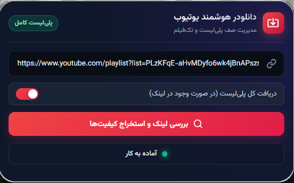
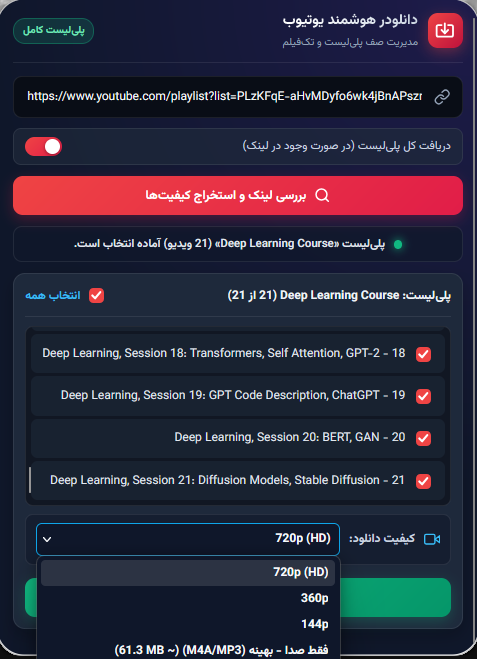
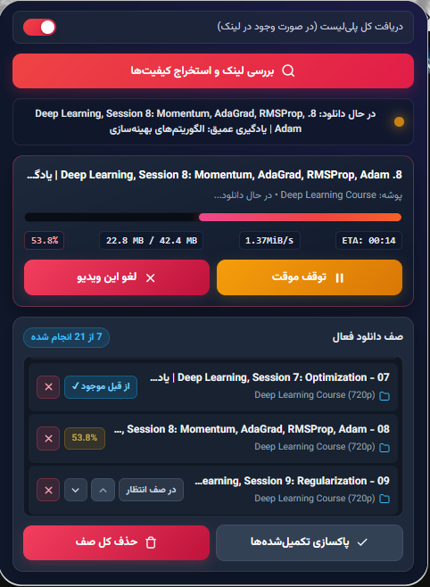

<div dir="rtl" align="right">

# 🎬 دانلودر هوشمند پلی‌لیست و تک‌فیلم یوتیوب (YouTube Playlist Queue Downloader)


یک افزونه مرورگر حرفه‌ای با ظاهر مدرن **Dark Glassmorphism** به همراه سرور محلی پایتون (`Flask` + `yt-dlp`) برای دانلود تکی و نوبتی ویدیوها و پلی‌لیست‌های یوتیوب با حافظه دائمی در پس‌زمینه.

---

## 🖼️ تصاویر محیط افزونه (Screenshots)

> 💡 **راهنما برای شما (قبل از انتشار این خط را پاک کنید):** از بخش‌های مختلف اکستنشن اسکرین‌شات بگیرید، آن‌ها را در پوشه‌ای به نام `screenshots` در مخزن خود قرار دهید و نام فایل‌ها را مطابق لینک‌های زیر بگذارید.

### ۱. نمای کلی و تشخیص هوشمند نوع لینک
<p align="center">
  
</p>

### ۲. استخراج پلی‌لیست و انتخاب کیفیت‌های واقعی
<p align="center">
  
</p>

### ۳. نوار پیشرفت زنده و مدیریت صف دانلود
<p align="center">
  
</p>

---

## ✨ ویژگی‌ها و امکانات کلیدی

* 🧠 **تشخیص هوشمند ساختار لینک یوتیوب:**
  * شناسایی خودکار لینک‌های **تک‌فیلم** (`watch?v=...`، `youtu.be`، `shorts`، `live`)، **پلی‌لیست کامل** (`playlist?list=...`) و **لینک‌های ترکیبی** (ویدیو به همراه پلی‌لیست).
  * قفل هوشمند سوییچ پلی‌لیست با انیمیشن هشدار برای جلوگیری از انتخاب اشتباه.
* ✏️ **سفارشی‌سازی نام خروجی پیش از دانلود:**
  * امکان ویرایش و تغییر نام پوشه مقصد (پوشه ذخیره‌سازی) برای تک‌فیلم‌ها یا پلی‌لیست‌ها.
  * قابلیت ویرایش عنوان تک‌تک ویدیوها (نام فایل نهایی) به صورت دلخواه پیش از اضافه کردن به صف دانلود.
* 📊 **استخراج کیفیت‌های واقعی (Real-time Formats):**
  * نمایش تمام کیفیت‌های واقعی موجود برای ویدیو (از `144p` تا `4K 60fps`) به همراه تخمین حجم فایل و گزینه **فقط صدا (M4A/MP3)**.
* 🔄 **صف دانلود دائمی در پس‌زمینه (Persistent Queue):**
  * ذخیره خودکار وضعیت صف در حافظه مرورگر (`storage.local`)؛ حتی با بستن پنجره پاپ‌آپ یا بسته شدن مرورگر، صف دانلود حفظ شده و قابل ادامه است.
* ⚡ **پنل نمایش زنده وضعیت دانلود:**
  * نمایش لحظه‌ای درصد پیشرفت، حجم دانلودشده از کل، سرعت دانلود (`Speed`) و زمان باقی‌مانده (`ETA`).
* ⏯️ **کنترل کامل روی دانلودها:**
  * قابلیت **توقف موقت (Pause)** و **ادامه دانلود (Resume)** از همان نقطه قبلی.
  * قابلیت **لغو دانلود فعلی (Cancel)** و حذف خودکار فایل‌های موقت و ناقص (`.part`، `.ytdl`).
  * امکان تغییر اولویت ویدیوهای در صف انتظار با دکمه‌های `▲` و `▼` و تلاش مجدد (`Retry`) برای موارد خطاخورده.
* 🛡️ **جلوگیری از دانلود تکراری:**
  * بررسی هوشمند فایل‌های موجود در پوشه مقصد و تطبیق دقیق مدت‌زمان ویدیو با استفاده از `ffprobe` برای رد کردن (`Skip`) فایل‌های سالم قبلی.

---

## 🛠️ پیش‌نیازها و نصب

### ۱. پیش‌نیازهای سیستم
1. نصب بودن **Python 3.8** یا بالاتر.
2. نصب بودن **FFmpeg** (و `ffprobe`) روی سیستم و قرار داشتن آن در `PATH` ویندوز/لینوکس (برای ترکیب صدا و تصویر کیفیت‌های بالا و بررسی سلامت فایل‌ها).

### ۲. راه‌اندازی سرور پایتون
ابتدا مخزن را کلون کرده و کتابخانه‌های مورد نیاز را نصب کنید:

</div>

```bash
git clone https://github.com/YOUR_USERNAME/youtube-playlist-queue-downloader.git
cd youtube-playlist-queue-downloader
pip install flask flask-cors yt-dlp
```

<div dir="rtl" align="right">

سپس سرور را اجرا کنید:

</div>

```bash
python server.py
```

<div dir="rtl" align="right">

سرور روی آدرس `http://127.0.0.1:8000` آماده به کار می‌شود و پوشه‌ای به نام `YouTube_Downloads` برای ذخیره‌سازی منظم ویدیوها و پلی‌لیست‌ها می‌سازد.

### ۳. نصب افزونه روی مرورگر
* **در فایرفاکس (Firefox):**
  1. در نوار آدرس عبارت `about:debugging#/runtime/this-firefox` را وارد کنید.
  2. روی دکمه **Load Temporary Add-on...** کلیک کنید.
  3. فایل `manifest.json` موجود در پوشه پروژه را انتخاب کنید.
* **در کروم / اج / بریو (Chromium):**
  1. به آدرس `chrome://extensions/` بروید و حالت **Developer mode** را فعال کنید.
  2. روی **Load unpacked** کلیک کرده و پوشه پروژه را انتخاب کنید.

---

## 📁 ساختار فایل‌های پروژه

* `manifest.json`: پیکربندی افزونه و دسترسی‌های مورد نیاز مرورگر.
* `popup.html`: ساختار ظاهری مدرن افزونه با تم Dark Glassmorphism و آیکون‌های برداری (SVG).
* `popup.js`: منطق رابط کاربری، اعتبارسنجی لینک‌ها، مدیریت ویرایش نام پوشه‌ها و فایل‌ها و ارتباط لحظه‌ای با پس‌زمینه.
* `background.js`: مدیریت دائمی صف دانلود در پس‌زمینه و ارتباط با سرور پایتون.
* `server.py`: سرور محلی Flask برای استخراج اطلاعات از یوتیوب، مدیریت دانلود با `yt-dlp` و پاک‌سازی فایل‌های ناقص.

---

## 📜 لایسنس (License)
این پروژه تحت لایسنس **MIT** منتشر شده است.

</div>